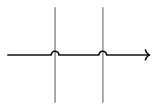

# tikz-hops

A TikZ library that makes a path hop over the paths it crosses.



```latex
\usepackage{tikz-hops}           % or \usetikzlibrary{hops}
...
\path[spath/save=a] (1,-1) -- (1,1);
\path[spath/save=b] (2,-1) -- (2,1);
\draw[->, hop over={a,b}] (0,0) -- (3,0);
```

`\drawhop[<options>]{<names>}{<path>}` is a shorthand for
`\draw[hop over={<names>}, <options>] <path>;`.
Keys `hops/gap`, `hops/height`, `hops/shape` (`arc`, `square`, `gap`) and
`hops/side` (`upright`, `left`, `right`) control the hop.
The manual is `doc/tikz-hops-doc.pdf`, built with `l3build doc`.

## Install

From TeX Live or MiKTeX once released on CTAN, or copy `tikz-hops.sty` and
`tikzlibraryhops.code.tex` next to your document.
Requires TeX Live 2022 or later with `spath3` 2.8 or later.
pdfLaTeX, LuaLaTeX and XeLaTeX are tested.

## Develop

```
l3build check      # regression tests on pdfTeX, LuaTeX and XeTeX
l3build doc        # manual
l3build ctan       # tikz-hops-ctan.zip
cd test && TEXINPUTS=..: latexmk -pdf visual.tex   # all cases on one page
```

## Related packages

- `knots` library of `spath3`: over/under gaps without hop arcs.
- `circuitikz`: `jump crossing` for circuit wires.

## License and author

LaTeX Project Public License 1.3c or later. See `LICENSE`.
Copyright (C) 2026 Yusuke Izawa.
